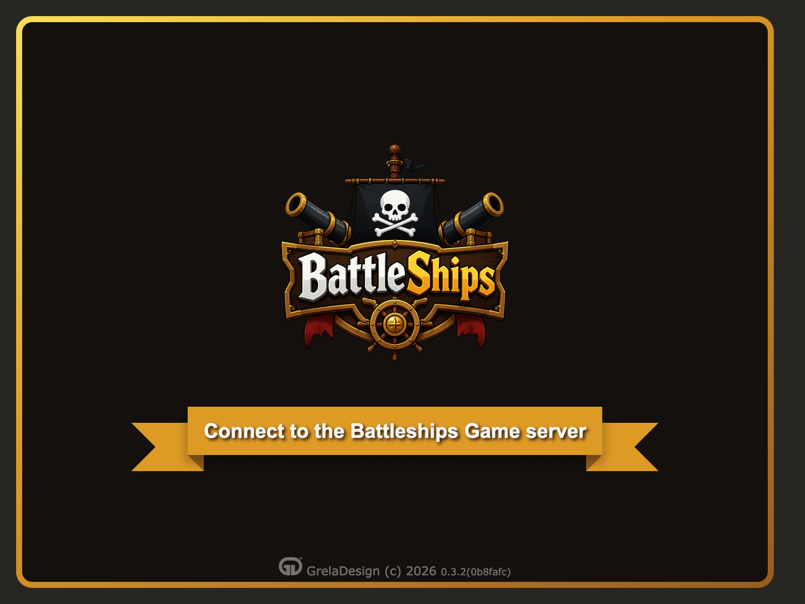
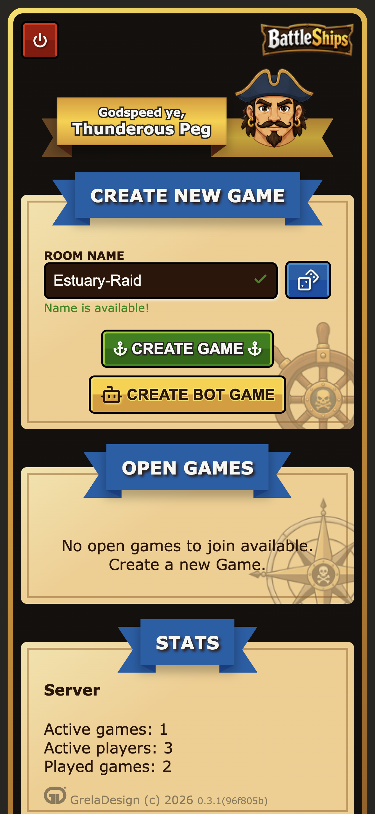
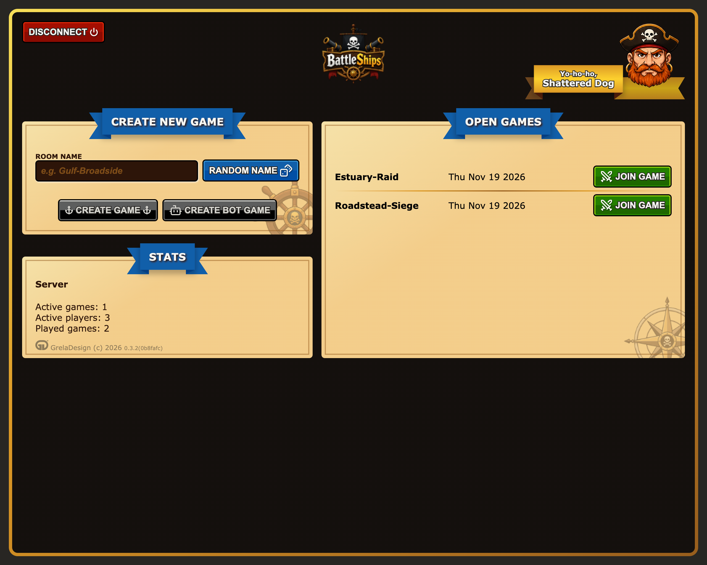
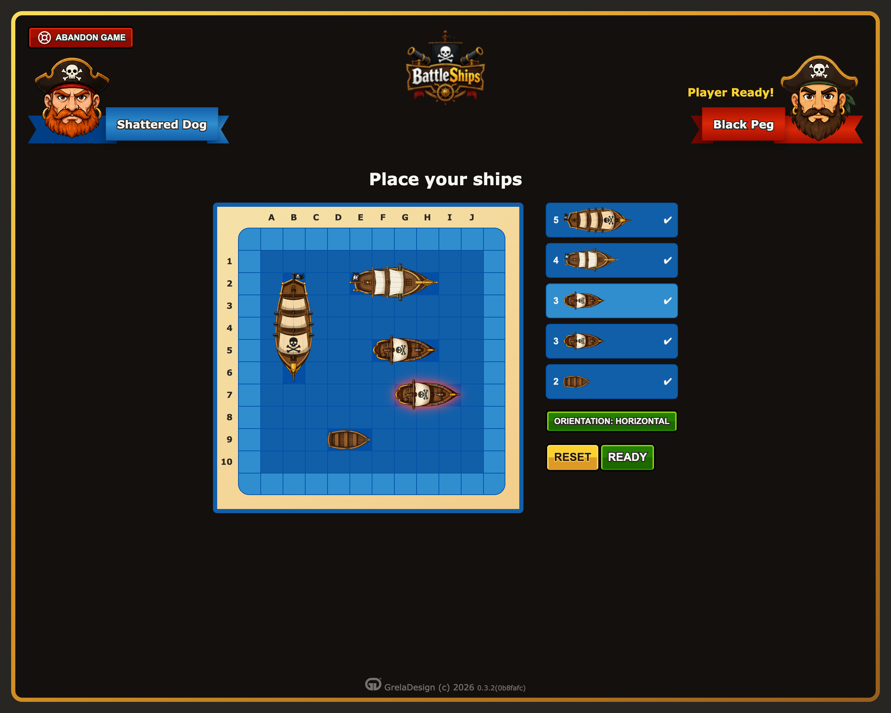
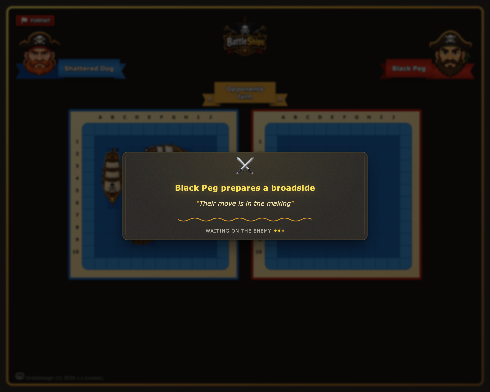

# Battle-Ships Game

A one-on-one battle-ships game built as a TypeScript monorepo with a Socket.IO game server and a React/Vite web client.

<p align="center">
  
</p>

[Screenshots](#screenshots)

## Repository overview

The monorepo is organized as follows:

- `apps/server` — authoritative server and socket handlers
- `apps/web` — React + Vite client
- `packages/game-logic` — shared board and gameplay rules
- `packages/types` — shared TypeScript contracts for event payloads and runtime state

## Tech stack

- TypeScript
- Socket.IO
- Vite + React for the client
- Vitest for tests
- Turbo for workspace orchestration
- pnpm workspaces

## Requirements

- Node.js 24+
- pnpm 11+

## Runtime setup

Install dependencies from the repository root:

```sh
pnpm install
```

Run the whole app locally:

```sh
pnpm dev
```

This starts:

- web app: http://localhost:3100
- server: http://localhost:3101

## Useful commands

```sh
pnpm build
pnpm lint
pnpm test
```

## Server behavior summary

The server owns the session registry and room lifecycle. It keeps the client session as the source of truth, and socket IDs are treated as ephemeral values that may change on reconnect.

Key rules:

- `clientId` identifies the player across reconnects.
- `socketId` is refreshed whenever the client reconnects.
- `gameId` is restored only when the room still exists.
- `game_updated` is emitted with the real room state or `null` when there is no active room.
- stale disconnects from playing game maintain a reconnect grace period before a room is forfeited.
- a finished room stays alive for a short grace window (5 minutes) so the result can be read and a rematch can start, then it is torn down together with its bot.
- `playedGames` in `server_stats` is a lifetime counter backed by the game statistics store, not by the rooms currently living in the registry.
- a single room can host many battles: every accepted rematch starts a new battle and is counted separately.

## Player identity

There is no login functionality, each player has token assigned at first connection which is then stored on users machine. This token identifies players machine only, it stores player id with a seed number. The seed is used to pick player's avatar and pick piratey name. There is only 48 avatars so it may happen that 2 opponents has the same avatar.

## Rematch flow

When a game has ended, the losing player may request a rematch. The winner may then accept or reject it.

Flow:

1. loser calls `request_rematch`
2. server stores the pending rematch request on the finished room
3. winner calls `accept_rematch` or `reject_rematch`
4. if accepted, the room is reset to the `placement` phase in the same room name and both players are re-prepared for a new round
5. if rejected, the loser cannot issue another rematch request for that finished game

This is handled in the room lifecycle and socket event layer, not by creating a brand-new room.

## Bot opponents

A room can be filled with a server-side bot instead of a waiting human. The bot is a regular `IPlayer` with `botLevel` set (`easy`, `medium`, `hard`), so it travels through the same room state and socket broadcasts as a human opponent.

- `bot_opponent` — seat a bot in an existing room (optional `difficulty`)
- `create_game_with_bot` — create a room with the bot already seated
- the difficulty is validated at runtime; unknown values are rejected instead of being stored
- bot ids are prefixed with `bot-` and are scoped to a single room
- a bot acts through the same room API as a human (`room.attack(...)`), so it cannot bypass turn or board rules
- a room with a bot leaves `open_games` as soon as the bot is seated (it is no longer waiting), and the bot is disposed together with its room

## Game statistics

Finished battles are appended to a dedicated statistics store (`GameStatsService`) instead of being derived from live rooms. `server_stats` carries `TStats`:

- `activePlayers` — connected sessions
- `activeGames` — rooms currently in play
- `playedGames` — lifetime number of finished battles

Every battle is stored at most once under the key `<roomId>#<battleIndex>`, so a finished room can be deleted (leave, forfeit, rematch, TTL) without decreasing the counter, and a rematch is counted as a separate battle in the same room.

A record keeps the room identity and name, the battle index, the finish timestamp, a `byForfeit` flag, the result for every participant (`win` / `lost`) and a free-form `meta` bag for future game data (rounds, duration, sunk ships, …). Per-player aggregates (played / wins / losses, including forfeits) are derived from those records; bots are stored in the record but skipped in per-player aggregation, because their ids only exist inside one room.

The store lives in server memory. With state persistence enabled (see below) the records are part of the snapshot and survive a restart; without it the lifetime counter resets together with the rooms. Replacing it with a database means implementing `IGameStatsService` and keeping the existing singleton.

## Server state persistence

A restart (deploy, `systemctl restart`, reboot) no longer wipes battles in progress: the server writes a snapshot of its runtime state to disk and restores it during startup, before the first socket handshake is handled.

Persistence is opt-in. Any of `STATE_ENABLED`, `STATE_DIR` or `STATE_SAVE_TOKEN` turns it on, `STATE_ENABLED=false` forces it off, and when it is off nothing is read or written — local development and the test suite stay file-free.

| Variable | Default | Meaning |
| --- | --- | --- |
| `STATE_ENABLED` | auto | `1` / `true` / `on` forces persistence on, `0` / `false` / `off` forces it off |
| `STATE_DIR` | `~/.battle-ships-game/state` | Directory holding `server-state.json` — keep it **outside the repository** |
| `STATE_SAVE_TOKEN` | – | Token for `POST /admin/state/save`; without it the endpoint is not mounted at all |

What the snapshot contains: every live room (both boards, ships left, turn, phase, battle index, rematch request), client sessions (including `disconnectedAt`), the claimed room names and the finished-battle statistics.

Restore policy:

- a `Finished` room comes back with the rematch state reset, and its TTL is counted from the moment the battle ended, not from the restart;
- a room with a bot is closed (`restore-no-bot`) — the bot brain is not serialized in stage 1, so a bot seat cannot be resumed;
- a room without human players is closed (`restore-empty`);
- a room that fails deserialization is skipped (`restore-deserialize-error`);
- sessions return with their old `disconnectedAt`, and the reconnect window after a restart is **90 s** (`RESTART_RECONNECT_GRACE_MS`), so nobody is forfeited while reloading the page.

Snapshot file: `server-state.json` with the envelope `{ version, savedAt, checksum, state }`, where `checksum` is a SHA-256 of the payload. Writes are atomic (`.tmp` + `rename`). A corrupt or tampered file is **moved aside** to `server-state.json.corrupt-<stamp>` and reported as `corrupt`, so the next start sees `missing` instead of quarantining the same file forever. An unknown envelope version is rejected rather than guessed.

Write triggers:

- `POST /admin/state/save` — planned save before a restart;
- `SIGTERM` / `SIGINT` — save, then `httpServer.close()`, then exit; bounded by `SHUTDOWN_SAVE_TIMEOUT_MS` (10 s) and a hard exit 5 s later;
- autosave every `AUTOSAVE_INTERVAL_MS` (15 s), started only after the restore, so an empty snapshot can never overwrite a restored one. This is the crash-recovery path: an unplanned kill loses at most a few moves.

### HTTP endpoints

| Endpoint | Auth | Response |
| --- | --- | --- |
| `GET /health` | none | `{ status, uptime, timestamp, clientsCount, version }` |
| `POST /admin/state/save` | `x-state-token: <token>` or `Authorization: Bearer <token>` | `{ ok: true, savedAt, rooms, sessions, gameStats }` |

A missing token, a wrong token, a wrong method and an unknown path all return a bare `404` with an empty body, so the endpoint cannot be discovered by probing. A genuine save failure with a valid token returns `500`, which only the authenticated caller can see.

## Deployment on a server (controlled restart)

The server is a plain Node process. The deploy has two independent halves: **build while the old process keeps serving**, then **restart once** and let the shutdown hook save the snapshot.

### 1. Runtime environment

Keep the state settings in the service environment, not in the `.env` that a deploy script regenerates next to the build:

```sh
sudo install -d -m 0750 -o battleship -g battleship /var/lib/battle-ships
sudo install -m 0600 -o root -g root /dev/null /etc/battle-ships.env
sudo tee /etc/battle-ships.env >/dev/null <<'EOF'
STATE_ENABLED=1
STATE_DIR=/var/lib/battle-ships
STATE_SAVE_TOKEN=<openssl rand -hex 32>
EOF
```

`STATE_DIR` outside the checkout is not cosmetic: `git clean`, a dependency reinstall or a rebuild of `apps/server/dist` must never be able to delete the saved games. `StateDirectory=` in the unit creates the directory with the right owner on boot.

### 2. systemd unit

```ini
[Unit]
Description=Battle-Ships game server
After=network-online.target
Wants=network-online.target

[Service]
Type=simple
User=battleship
WorkingDirectory=/home/battleship/battle-ships/apps/server/dist
ExecStart=/usr/bin/node index.js
EnvironmentFile=/etc/battle-ships.env
Environment=PORT=3101
Environment=HOST=0.0.0.0
StateDirectory=battle-ships
StateDirectoryMode=0750

# controlled stop: SIGTERM -> save snapshot -> exit
KillSignal=SIGTERM
KillMode=mixed
TimeoutStopSec=30
Restart=on-failure
RestartSec=3

[Install]
WantedBy=multi-user.target
```

`TimeoutStopSec=30` leaves the 10 s save budget plus the hard-exit margin untouched. `Restart=always` with `RestartSec=0` would restart inside the 90 s reconnect window and drop the players anyway — do not use it.

### 3. Deploy script

```bash
#!/usr/bin/env bash
# pull -> build -> pre-save -> restart -> verify
set -euo pipefail

APP_DIR="$HOME/homelab/nodeapps/battle-ships"
SERVER_DIST="$APP_DIR/apps/server/dist"
STATE_FILE="/var/lib/battle-ships/server-state.json"
PORT="${PORT:-3101}"
SERVICE="battleship-server"
BASE="http://127.0.0.1:$PORT"

# read the token from the unit environment, never from argv (`ps` is world-readable)
TOKEN="$(sudo sed -n 's/^STATE_SAVE_TOKEN=//p' /etc/battle-ships.env)"
BRANCH="${1:-$(git -C "$APP_DIR" rev-parse --abbrev-ref HEAD)}"

# 1. source + build, no downtime yet
git -C "$APP_DIR" fetch --prune origin
git -C "$APP_DIR" checkout "$BRANCH"
git -C "$APP_DIR" pull --ff-only origin "$BRANCH"
cd "$APP_DIR"
pnpm install --frozen-lockfile
pnpm build

[[ -d "$SERVER_DIST" ]] || { echo "ERROR: missing $SERVER_DIST" >&2; exit 1; }
cat > "$SERVER_DIST/.env" <<'EOF'
PORT=3101
HOST=0.0.0.0
ALLOWED_ORIGINS=http://192.168.1.32:3100,http://192.168.1.41:3100
EOF

# 2. pre-save: abort before touching a running server if the snapshot fails
code="$(curl -s -o /tmp/state-save.json -w '%{http_code}' \
  -X POST "$BASE/admin/state/save" -H "x-state-token: $TOKEN" || true)"
if [[ "$code" != "200" ]]; then
  echo "ERROR: pre-save returned $code (want 200), aborting before restart" >&2
  cat /tmp/state-save.json >&2 || true
  exit 1
fi

# 3. keep the previous snapshot in case the new build misreads it
sudo cp -a "$STATE_FILE" "$STATE_FILE.bak-$(date +%Y%m%d-%H%M%S)" 2>/dev/null || true

# 4. one restart; SIGTERM triggers a second, in-process save
sudo systemctl restart "$SERVICE"

# 5. wait for health, then confirm the restore line in the journal
for i in $(seq 1 30); do
  curl -fsS "$BASE/health" >/dev/null 2>&1 && break
  sleep 1
  [[ "$i" -eq 30 ]] && { echo "ERROR: no /health after 30 s" >&2; exit 1; }
done
sudo journalctl -u "$SERVICE" --since "2 min ago" --no-pager \
  | grep -E "State restored|No state restored|State persistence|\[shutdown\]" || true
```

A `404` from the pre-save means the token is missing or wrong (the endpoint is deliberately indistinguishable from a missing path), a `500` means the save itself failed. Both abort the deploy while the old process is still serving.

### 4. Verifying a deploy

```sh
curl -fsS http://127.0.0.1:3101/health
sudo journalctl -u battleship-server -n 20 --no-pager
sudo ls -l /var/lib/battle-ships/
```

The start log must contain either `State restored from … (saved …)` with room/session/result counts, or `No state restored (<reason>)` on the very first run. `server-state.json` must be newer than the previous deploy, owned by the service user.

### 5. Rollback

```sh
git -C "$APP_DIR" checkout <previous-commit>
pnpm install --frozen-lockfile && pnpm build
sudo systemctl restart battleship-server
```

The snapshot stays on disk. A build without state support simply ignores it; restore the `.bak-*` copy taken before the deploy if the newer build already rewrote it and you want the older games back.

### 6. Rules that keep the snapshot intact

- never `kill -9`, `systemctl kill -s SIGKILL` or `docker stop -t 0` — those skip the shutdown hook and fall back to the 15 s autosave;
- do not shorten `TimeoutStopSec` below the 10 s save budget;
- build first, restart second — the outage is the restart, not the compilation;
- do not put `STATE_DIR` inside the repository or inside `apps/server/dist`;
- a restart loop inside the 90 s reconnect window forfeits the players anyway, because the second disconnect happens before they can come back.

## Shared contracts

The game contract is defined in the shared types package. It includes the room lifecycle phases, session shape, and all Socket.IO events used by the server and web client.

## Validation

From the server package, run the test suite:

```sh
cd apps/server
pnpm test
```

The suite covers reconnect restoration, room lifecycle transitions, disconnect handling, the rematch flow, the bot lifecycle (`src/bots/BotRunner.e2e.test.ts`), the finished-game summary and the statistics store (`src/services/game-stats.service.test.ts`).

## Screenshots

<p align="center">
  
</p>
<p align="center">
  
  
</p>
<p align="center">
  
</p>
<p align="center">
  
  
  
</p>
<p align="center">
  
</p>
<p align="center">
  
</p>
