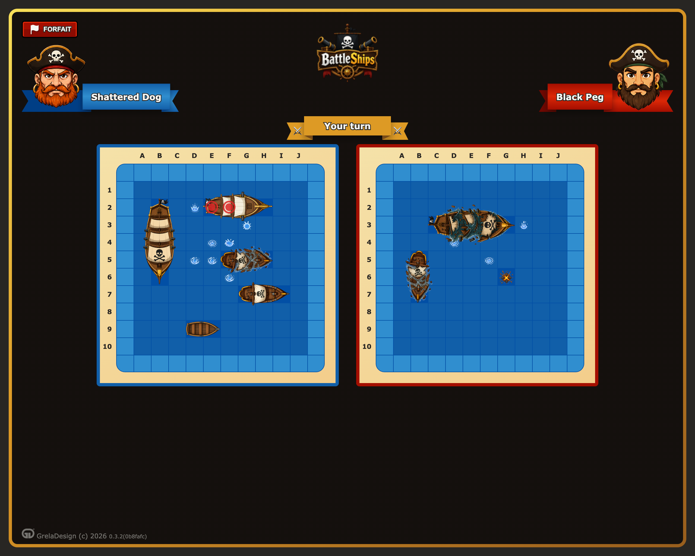
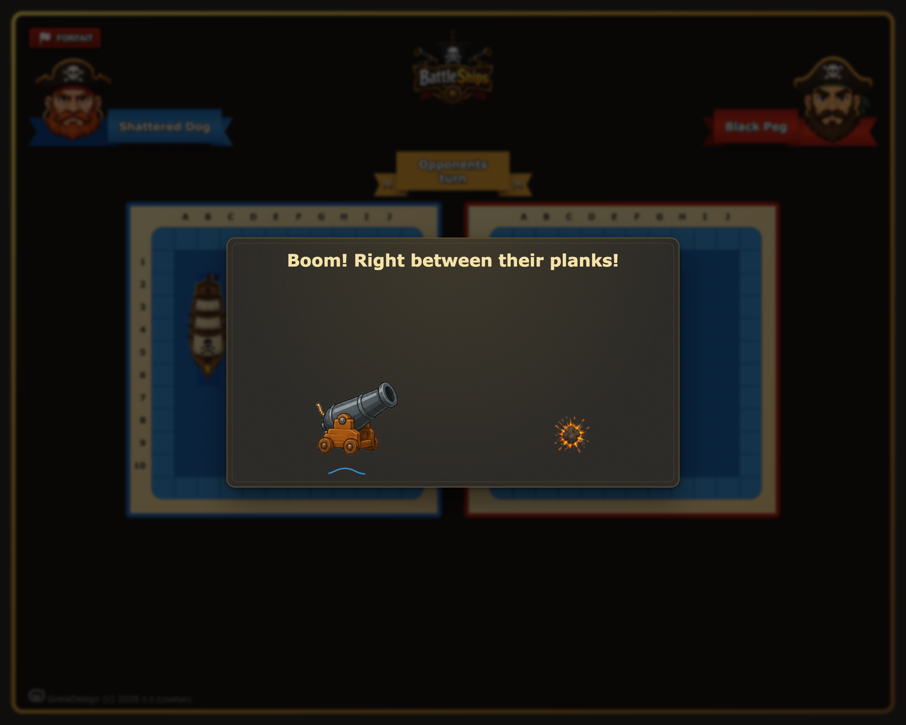
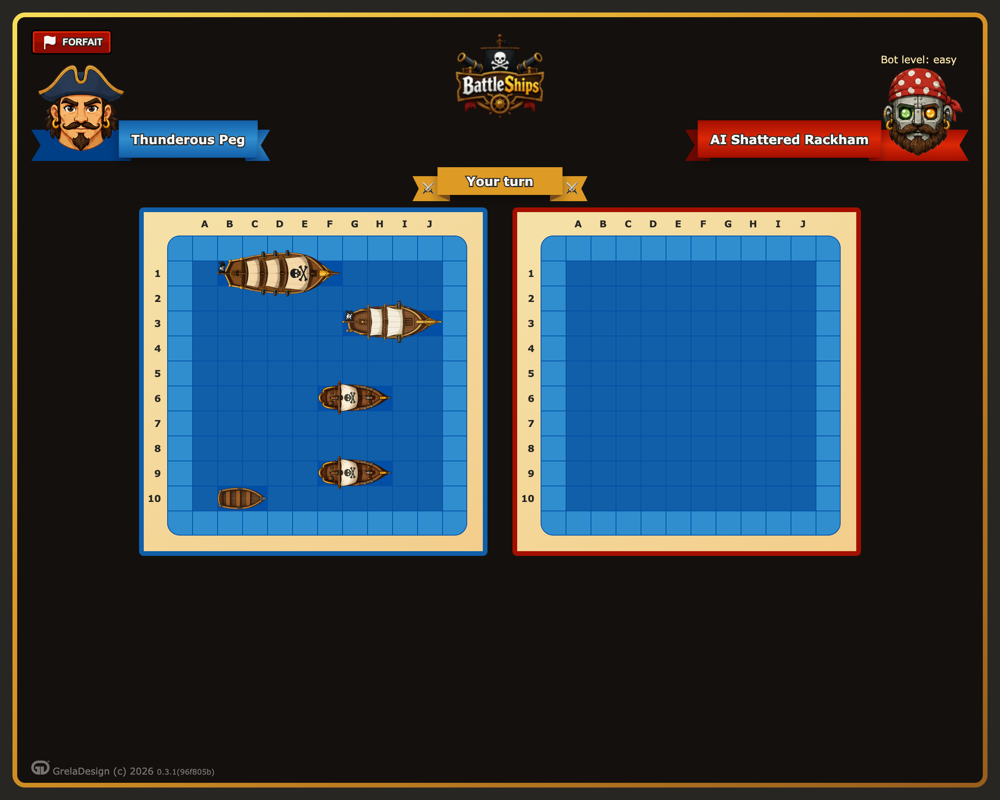
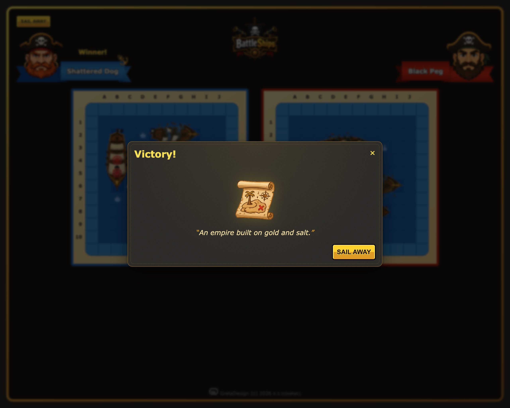

# Battle-Ships Game

A one-on-one battle-ships game built as a TypeScript monorepo with a Socket.IO game server and a React/Vite web client.

## Screenshots
<p align="center">
  
</p>
<p align="center">
  
  
</p>
<p align="center">
  
</p>
<p align="center">
  
  
  
</p>
<p align="center">
  
</p>
<p align="center">
  
</p>


## Repository overview

The monorepo is organized as follows:

- `apps/server` — authoritative server and socket handlers
- `apps/web` — React + Vite client
- `packages/game-logic` — shared board and gameplay rules
- `packages/types` — shared TypeScript contracts for event payloads and runtime state

## Tech stack

- TypeScript
- Socket.IO
- Vite + React for the client
- Vitest for tests
- Turbo for workspace orchestration
- pnpm workspaces

## Requirements

- Node.js 24+
- pnpm 11+

## Runtime setup

Install dependencies from the repository root:

```sh
pnpm install
```

Run the whole app locally:

```sh
pnpm dev
```

This starts:

- web app: http://localhost:3100
- server: http://localhost:3101

## Useful commands

```sh
pnpm build
pnpm lint
pnpm test
```

## Server behavior summary

The server owns the session registry and room lifecycle. It keeps the client session as the source of truth, and socket IDs are treated as ephemeral values that may change on reconnect.

Key rules:

- `clientId` identifies the player across reconnects.
- `socketId` is refreshed whenever the client reconnects.
- `gameId` is restored only when the room still exists.
- `game_updated` is emitted with the real room state or `null` when there is no active room.
- stale disconnects from playing game maintain a reconnect grace period before a room is forfeited.
- a finished room stays alive for a short grace window (5 minutes) so the result can be read and a rematch can start, then it is torn down together with its bot.
- `playedGames` in `server_stats` is a lifetime counter backed by the game statistics store, not by the rooms currently living in the registry.
- a single room can host many battles: every accepted rematch starts a new battle and is counted separately.

## Player identity

There is no login functionality, each player has token assigned at first connection which is then stored on users machine. This token identifies players machine only, it stores player id with a seed number. The seed is used to pick player's avatar and pick piratey name. There is only 48 avatars so it may happen that 2 opponents has the same avatar.

## Rematch flow

When a game has ended, the losing player may request a rematch. The winner may then accept or reject it.

Flow:

1. loser calls `request_rematch`
2. server stores the pending rematch request on the finished room
3. winner calls `accept_rematch` or `reject_rematch`
4. if accepted, the room is reset to the `placement` phase in the same room name and both players are re-prepared for a new round
5. if rejected, the loser cannot issue another rematch request for that finished game

This is handled in the room lifecycle and socket event layer, not by creating a brand-new room.

## Bot opponents

A room can be filled with a server-side bot instead of a waiting human. The bot is a regular `IPlayer` with `botLevel` set (`easy`, `medium`, `hard`), so it travels through the same room state and socket broadcasts as a human opponent.

- `bot_opponent` — seat a bot in an existing room (optional `difficulty`)
- `create_game_with_bot` — create a room with the bot already seated
- the difficulty is validated at runtime; unknown values are rejected instead of being stored
- bot ids are prefixed with `bot-` and are scoped to a single room
- a bot acts through the same room API as a human (`room.attack(...)`), so it cannot bypass turn or board rules
- a room with a bot leaves `open_games` as soon as the bot is seated (it is no longer waiting), and the bot is disposed together with its room

## Game statistics

Finished battles are appended to a dedicated statistics store (`GameStatsService`) instead of being derived from live rooms. `server_stats` carries `TStats`:

- `activePlayers` — connected sessions
- `activeGames` — rooms currently in play
- `playedGames` — lifetime number of finished battles

Every battle is stored at most once under the key `<roomId>#<battleIndex>`, so a finished room can be deleted (leave, forfeit, rematch, TTL) without decreasing the counter, and a rematch is counted as a separate battle in the same room.

A record keeps the room identity and name, the battle index, the finish timestamp, a `byForfeit` flag, the result for every participant (`win` / `lost`) and a free-form `meta` bag for future game data (rounds, duration, sunk ships, …). Per-player aggregates (played / wins / losses, including forfeits) are derived from those records; bots are stored in the record but skipped in per-player aggregation, because their ids only exist inside one room.

The store lives in server memory, so the lifetime counter resets when the server restarts. Replacing it with a database means implementing `IGameStatsService` and keeping the existing singleton.

## Shared contracts

The game contract is defined in the shared types package. It includes the room lifecycle phases, session shape, and all Socket.IO events used by the server and web client.

## Validation

From the server package, run the test suite:

```sh
cd apps/server
pnpm test
```

The suite covers reconnect restoration, room lifecycle transitions, disconnect handling, the rematch flow, the bot lifecycle (`src/bots/BotRunner.e2e.test.ts`), the finished-game summary and the statistics store (`src/services/game-stats.service.test.ts`).
