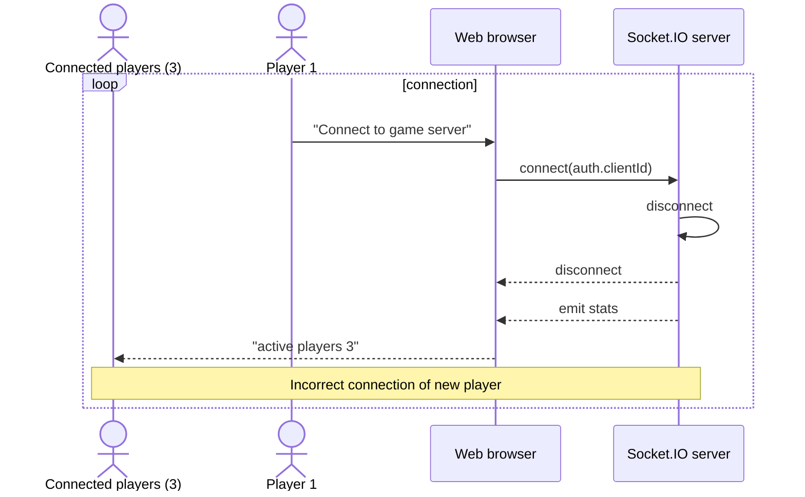
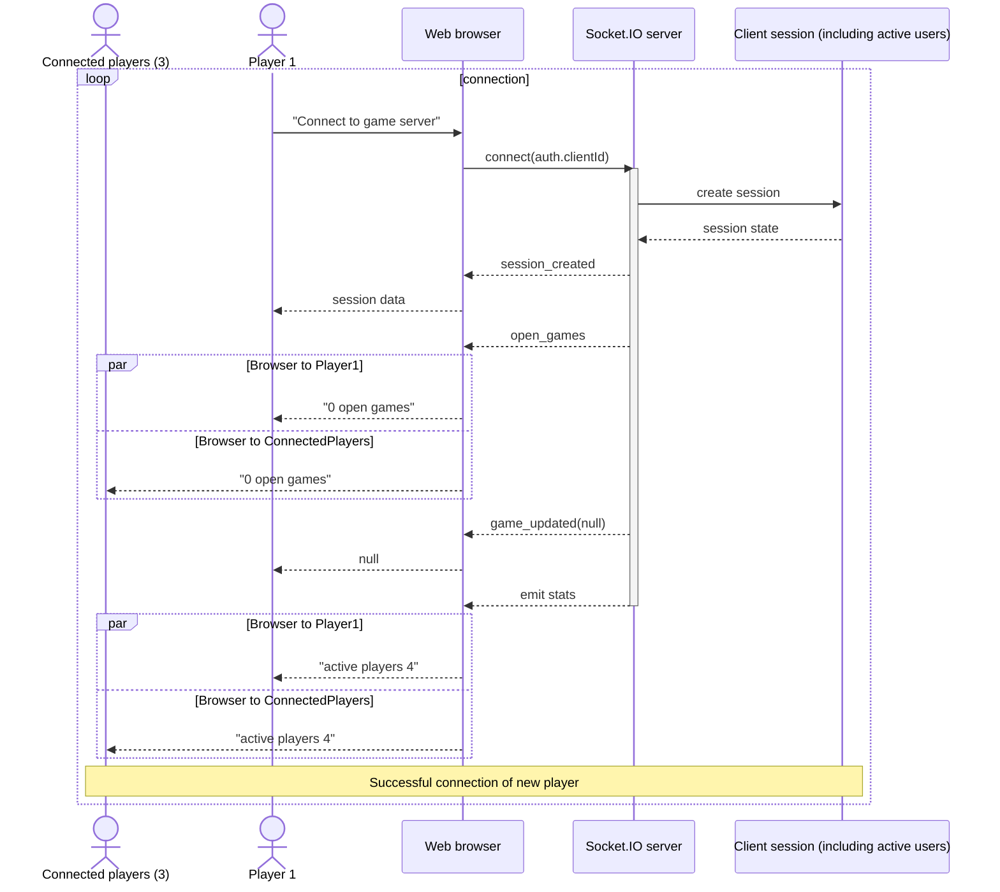
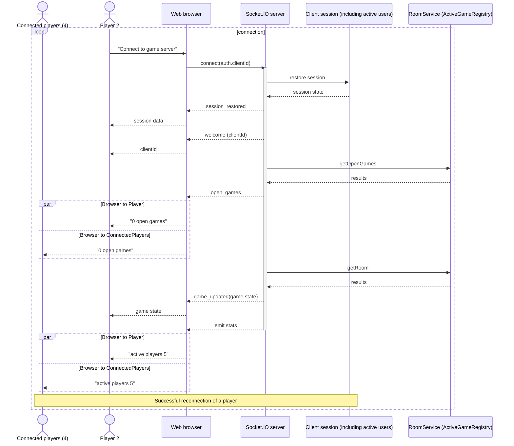
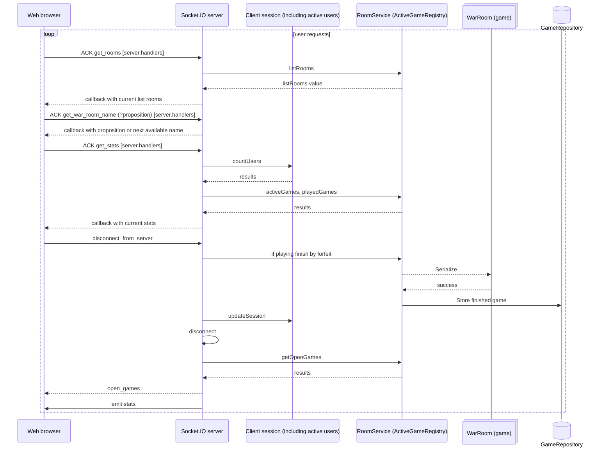
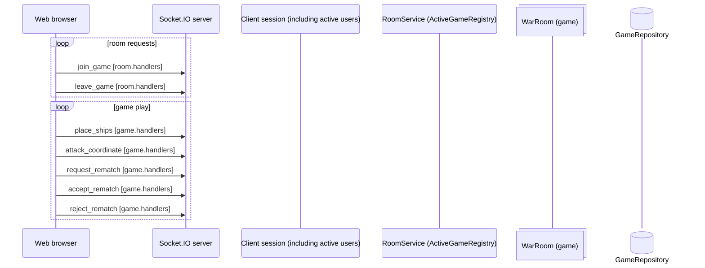

# Battleships game server

This server is the authoritative state machine for multiplayer battleship matches. It owns the client session registry, room lifecycle, disconnect policy, and Socket.IO-based game updates.

## Deployment

Following environment variables are required to be set on the server (process.env.*):
- NODE_ENV - set to "production"
- SESSION_SECRET - secret used to sign session tokens. [Read more](./src/security/README.md#session_secret)
- PORT - to change default (3101) value
- ALLOWED_ORIGIN - list of allowed origins

## Core model

### Sessions
The server keeps a persistent client session keyed by a stable client id. A session contains:

- `id`: stable client identity
- `socketId`: current live Socket.IO socket id
- `gameId`: current active room id
- `disconnectedAt`: timestamp when the player disconnected while in a game
- `name` and `seed`: player identity data

The session is the source of truth for reconnects. Socket ids are ephemeral and can change when the user reconnects with a new socket connection.

### Rooms
Each room is a game state object with a lifecycle phase:

- `waiting`
- `placement`
- `playing`
- `finished`

Room transitions are managed in `src/utils/gameLifeCycle.ts`.

## Connection and reconnect flow

When a socket connects, `factoryConnectHandler` in `src/socket/index.ts` runs the reconnect logic:

1. validate the `clientId` passed via `socket.handshake.auth.clientId`
2. register the room, game, and server event handlers
3. read the existing client session by `clientId`
4. if a session exists:
   - refresh `socketId`
   - clear `disconnectedAt`
   - restore `gameId` when the room still exists
   - emit `session_restored`
5. if no session exists:
   - create the session
   - emit `session_created`
6. emit `game_updated` with the real room state or `null` when no room is active
7. emit lobby data and stats

This is the reconnect contract: the server decides whether the client should be reattached to a valid game and sends the current state only after a successful restore.

## Disconnect behavior

The disconnect handler in `src/socket/handlers/socket.handlers.impl/disconnect.ts` treats the disconnect policy as follows:

- `playing`: the player is marked inactive and the room remains alive for a reconnect grace period
- `placement`: if only one player remains, the room is cleaned up; otherwise the room returns to `waiting`
- `waiting`: the room is destroyed and the lobby is refreshed
- stale socket: ignored when it does not match the current session socket id

The handler re-emits the room state using `emitRoomStateToPlayers` so any remaining player sees a fresh state after a transition.

## Reconnect grace policy

The server does not automatically forfeit a game the moment a socket disconnects during play. Instead, it stores the disconnect timestamp and keeps the room alive until the reconnect timeout expires.

The timeout is configurable via `GAME_RECONNECT_TIMEOUT_MS` and defaults to `60_000` ms.

The periodic cleanup for stale sessions is implemented in `src/utils/reconnectGrace.ts`.

## Room lifecycle operations

The main lifecycle operations live in `src/utils/gameLifeCycle.ts`:

- `createWarRoom`
- `destroyWarRoom`
- `transitionToPlacement`
- `transitionToWaiting`
- `applyShipsAndMarkReady`
- `transitionToPlaying`
- `updateRoomWithNewTurnData`
- `transitionToFinished`
- `requestRematch`
- `acceptRematch`
- `rejectRematch`

These functions keep the room, player sessions, and board state consistent as the game passes through waiting, placement, playing, and finished states.

## Rematch feature

After a finished game, the losing player may request a rematch. The winning player then decides whether to accept or reject it.

Requirements of the feature:

- only a player in the finished room may request a rematch
- the request is stored on the room as a pending rematch state
- the winner may accept to restart the same room in `placement` phase
- the winner may reject, which prevents the loser from issuing another rematch request for that finished game
- when accepted, the room is reset with fresh empty boards, fresh ship assignment, cleared results/history, and both players marked ready to place ships again

The server emits the rematch events to the connected players and keeps the same room id for the new round.

## Client contract

The frontend must not create or replace the session during a restore. The server restores the authoritative session and emits the correct `game_updated` data.

The client should react to:

- `session_created`
- `session_restored`
- `game_updated`
- `player_ready`
- `opponent_connected`
- `rematch_requested`
- `rematch_accepted`
- `rematch_rejected`

## Important rule

Session data is the source of truth.

A reconnecting client must be matched by the stored session and not by a stale socket id from a previous connection. This avoids the null or stale-state bug where the server emits `game_updated` to the wrong socket target.

# New Design
## App layers

### Connection
#### Invalid user connection sequence

#### New user connected

#### Successful reconnection (with session)

### User requests

### Game

