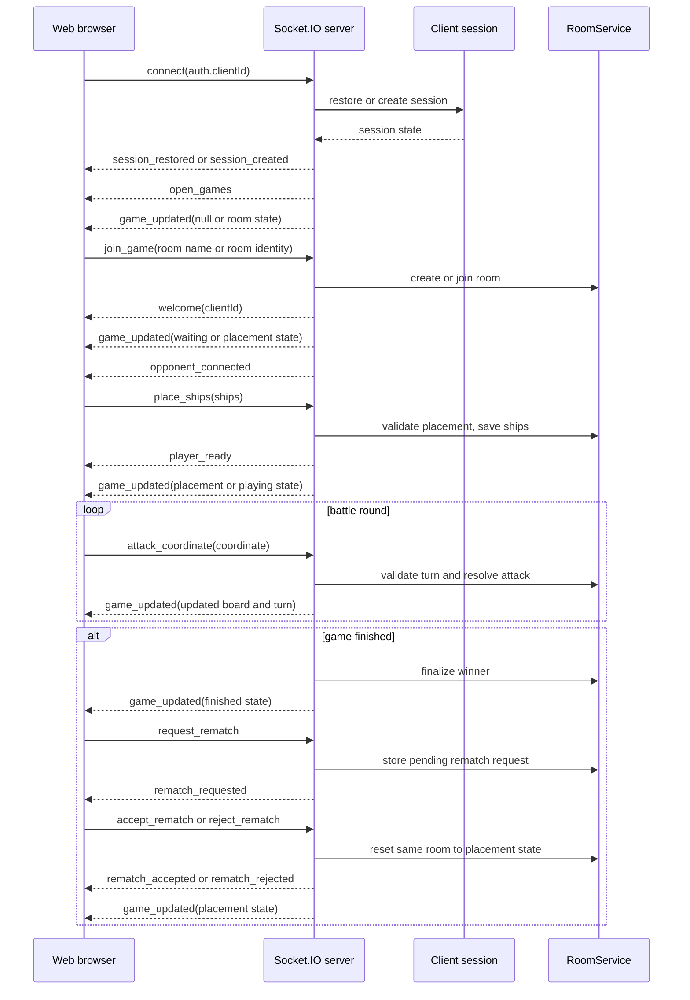

# Battleship Web App

The frontend for the Battleship game. It is a React 19 application built with Vite and communicates with the game server through Socket.IO.

## Requirements

- Node.js 24 or newer
- pnpm 11

Install dependencies from the repository root:

```sh
pnpm install
```

## Development

From the repository root, start both the web app and game server:

```sh
pnpm dev
```

The development URLs are:

- Web app: http://localhost:3100
- Socket.IO server: http://localhost:3101

The web app connects to port 3101 in development. No frontend environment variables are required.

To run only this app:

```sh
pnpm --filter @repo/web dev
```

The server must be running separately when using this command:

```sh
pnpm --filter @repo/server dev
```

## Production

Setup `VITE_SOCKET_URL` with the game server endpoint.

## Client-server flow

The client stores a persistent client ID in browser storage and sends it as Socket.IO authentication data. The server uses it to restore the client session and associate the player with a game.

The main client-to-server events are:

- `join_game`: create or join a room
- `leave_game`: leave the current room
- `place_ships`: submit ship placement
- `attack_coordinate`: attack a board coordinate
- `request_rematch`: ask the winner for a new round
- `accept_rematch`: accept the rematch request
- `reject_rematch`: reject the rematch request
- `get_rooms`: request the current room list
- `get_war_room_name`: request or validate a room name

The main server-to-client events are:

- `game_updated`: receive the current game state, or `null` when no game is active
- `open_games`: receive rooms waiting for an opponent
- `welcome`: receive the current client ID after joining
- `opponent_connected`: opponent joined the room
- `player_ready`: opponent finished ship placement
- `server_stats`: receive lobby statistics
- `session_restored` / `session_created`: session lifecycle notifications
- `rematch_requested`: opposing player asked for a rematch
- `rematch_accepted`: rematch was accepted and a new placement round is starting
- `rematch_rejected`: rematch was rejected

The server is authoritative for room state, ship placement validation, turns, attacks, and game results. The frontend renders the state received from `game_updated` and keeps the opponent's ship positions hidden during the playing phase.

## Communication event flow



## Rematch flow on the client

After a finished game, the losing side may request a rematch. The UI should listen for `rematch_requested` and present the choice to accept or reject. If the winner accepts, the game room is reset to `placement` and the same room continues for a new round. If the winner rejects, the loser is blocked from issuing another request for that same finished match.

## Application structure

- `src/App.tsx`: selects the lobby, waiting, placement, game, and game-over views
- `src/pages`: page-level game views
- `src/components`: reusable UI components
- `src/store`: socket event subscriptions and local game state
- `src/socket`: Socket.IO client setup
- `src/assets`: sprite and decoration helpers
- `src/test`: test setup

Production builds are generated in `apps/web/dist` by `pnpm build`. The production Socket.IO URL is same-origin, so deployment must either serve the frontend and Socket.IO server behind the same origin or provide the correct proxy configuration.
