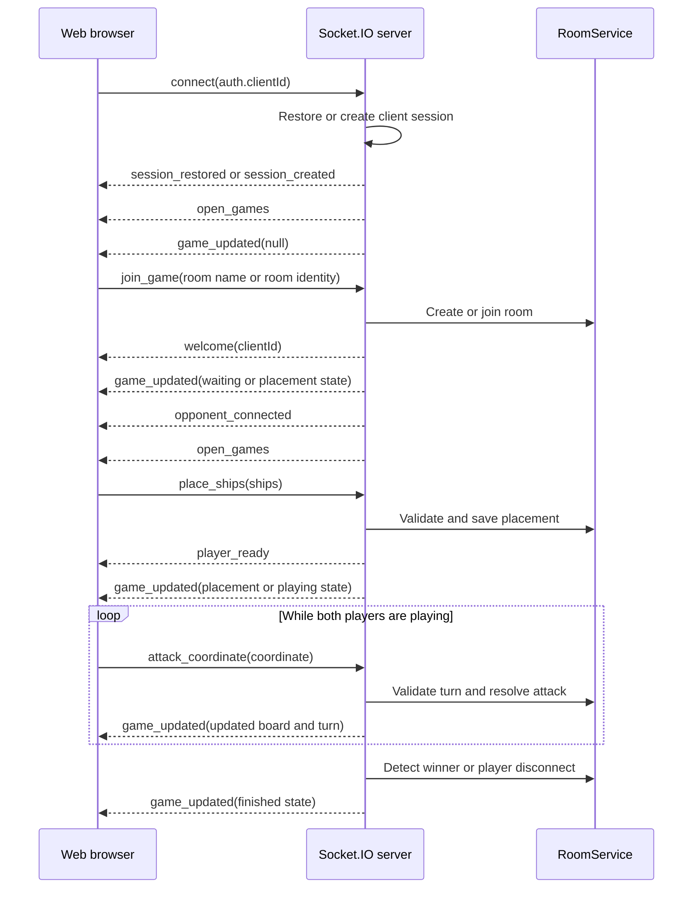

# Battleship Web App

The frontend for the Battleship game. It is a React 19 application built with Vite and communicates with the game server through Socket.IO.

## Requirements

- Node.js 24 or newer
- pnpm 11

Install dependencies from the repository root:

```sh
pnpm install
```

## Development

From the repository root, start both the web app and game server:

```sh
pnpm dev
```

The development URLs are:

- Web app: <http://localhost:3000>
- Socket.IO server: <http://localhost:3001>

The web app connects to port `3001` in development. No frontend environment variables are required.

To run only this app:

```sh
pnpm --filter @repo/web dev
```

The server must be running separately when using this command:

```sh
pnpm --filter @repo/server dev
```

## Scripts

Run these commands from `apps/web` or use the equivalent `pnpm --filter @repo/web <script>` command from the repository root.

| Command | Description |
| --- | --- |
| `pnpm dev` | Start the Vite development server on port 3000 |
| `pnpm build` | Type-check and build the production frontend |
| `pnpm preview` | Preview the production build locally |
| `pnpm test` | Run frontend Vitest tests |
| `pnpm lint` | Run ESLint |

Repository-wide equivalents are available from the root:

```sh
pnpm build
pnpm test
pnpm lint
pnpm check-types
```

## Client-server flow

The client stores a persistent client ID in browser storage and sends it as Socket.IO authentication data. The server uses it to restore the client session and associate the player with a game.

The main client-to-server events are:

- `join_game`: create or join a room
- `leave_game`: leave the current room
- `place_ships`: submit ship placement
- `attack_coordinate`: attack a board coordinate
- `get_rooms`: request the current room list
- `get_war_room_name`: request or validate a room name

The main server-to-client events are:

- `game_updated`: receive the current `TGameState`, or `null` when no game is active
- `open_games`: receive rooms waiting for an opponent
- `welcome`: receive the current client ID after joining
- `opponent_connected`: opponent joined the room
- `player_ready`: opponent finished ship placement
- `server_stats`: receive lobby statistics
- `session_restored` / `session_created`: session lifecycle notifications

The server is authoritative for room state, ship placement validation, turns, attacks, and game results. The frontend renders the state received from `game_updated` and keeps the opponent's ship positions hidden during the playing phase.

## Communication event flow



## Application structure

- `src/App.tsx`: selects the lobby, waiting, placement, game, and game-over views
- `src/pages`: page-level game views
- `src/components`: reusable UI components
- `src/store`: Zustand stores and Socket.IO event subscriptions
- `src/socket`: Socket.IO client setup
- `src/assets`: sprite and decoration helpers
- `src/test`: test setup

Production builds are generated in `apps/web/dist` by `pnpm build`. The production Socket.IO URL is same-origin, so deployment must serve the frontend and Socket.IO server behind the same origin or provide the appropriate hosting/proxy arrangement.
